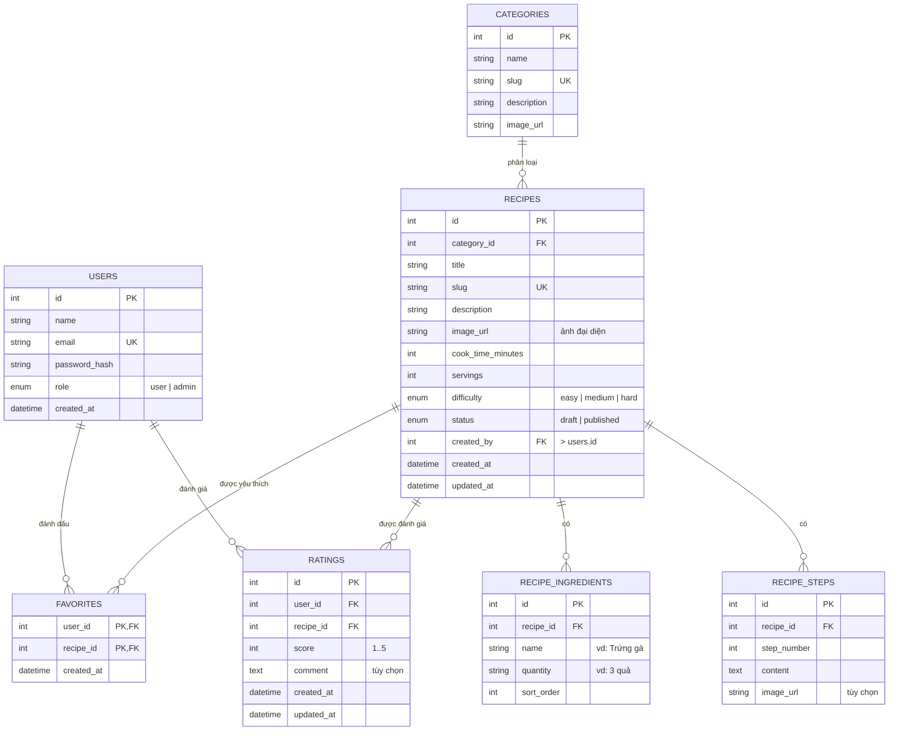

# Đặc tả yêu cầu phần mềm (SRS)
## Website Quản lý & Chia sẻ Công thức Nấu Ăn

- **Phiên bản:** 1.0 — 13/09/2026
- **Trạng thái:** Bản nháp để phê duyệt

---

## 1. Giới thiệu

### 1.1. Mục đích
Xây dựng website cho phép xem, tìm kiếm công thức nấu ăn theo nhóm món; người dùng có thể lưu công thức yêu thích và đánh giá món ăn; quản trị viên quản lý toàn bộ nội dung (công thức, danh mục, hình ảnh) thông qua trang quản trị.

### 1.2. Phạm vi
- **Trong phạm vi:** hiển thị công thức theo danh mục, trang chi tiết (tên, ảnh, nguyên liệu, các bước), tìm kiếm, tài khoản người dùng, yêu thích, đánh giá (sao), trang quản trị CRUD.
- **Ngoài phạm vi (v1):** đăng công thức bởi người dùng thường, bình luận thảo luận, chia sẻ lên mạng xã hội (chỉ làm nút copy link), thanh toán, đa ngôn ngữ, mobile app.

### 1.3. Đối tượng sử dụng (Actors)

| Actor | Mô tả | Quyền |
|---|---|---|
| **Khách (Guest)** | Người truy cập chưa đăng nhập | Xem danh mục, công thức, tìm kiếm |
| **Thành viên (User)** | Người dùng đã đăng nhập | Như Khách + yêu thích, đánh giá |
| **Quản trị viên (Admin)** | Người quản lý nội dung | Toàn quyền + trang quản trị |

---

## 2. Yêu cầu chức năng

Mã mức ưu tiên: **C** = Cốt lõi (bắt buộc), **N** = Nên có, **T** = Tùy chọn.

### FR1 — Hiển thị công thức theo nhóm món ăn (C)
- Trang chủ và trang danh mục hiển thị danh sách công thức dạng thẻ (card): ảnh đại diện, tên món, nhóm món, thời gian nấu, điểm đánh giá trung bình.
- Danh mục hiển thị dạng menu/điều hướng; mỗi danh mục có trang riêng liệt kê các công thức thuộc nhóm đó, có phân trang.
- Danh mục gợi ý ban đầu: Món chính, Món tráng miệng, Món khai vị, Món canh, Món chay, Đồ uống, Món ăn vặt.
- **Nghiệm thu:** truy cập `/danh-muc/<slug>` chỉ thấy công thức thuộc danh mục đó; danh sách trống hiển thị thông báo thân thiện.

### FR2 — Trang chi tiết công thức (C)
Mỗi công thức gồm các thông tin:
- Tên món, ảnh đại diện, mô tả ngắn, nhóm món, thời gian thực hiện, số khẩu phần, độ khó.
- **Nguyên liệu:** danh sách nhiều dòng (tên nguyên liệu + định lượng, vd: "Trứng gà — 3 quả"), hiển thị dạng checklist.
- **Các bước thực hiện:** danh sách bước đánh số, mỗi bước có nội dung văn bản (có thể kèm ảnh minh họa riêng cho từng bước).
- Điểm đánh giá trung bình (sao) và số lượt đánh giá.
- Nút "Yêu thích" (heart) và nút "Sao chép link chia sẻ".
- Công thức liên quan (cùng danh mục) ở cuối trang.
- **Nghiệm thu:** truy cập bằng URL dạng `/cong-thuc/<slug>`; công thức chưa xuất bản (draft) không xem được ở phía người dùng.

### FR3 — Tìm kiếm (C)
- Ô tìm kiếm ở header trên mọi trang.
- Từ khóa tìm kiếm khớp với: **tên món**, **tên nguyên liệu**, hoặc **nhóm món** (không phân biệt hoa thường, hỗ trợ tiếng Việt có dấu; debounce khi gõ).
- Bộ lọc kèm theo: chọn nhóm món; sắp xếp theo: mới nhất / điểm đánh giá cao nhất.
- Trang kết quả hiển thị số kết quả tìm thấy, highlight từ khóa, phân trang; trạng thái "không tìm thấy kết quả" rõ ràng.
- **Nghiệm thu:** gõ "cá" phải trả về cả món có tên chứa "cá" (Cá kho tộ) lẫn món có nguyên liệu "cá" (Canh chua có nguyên liệu cá); kết hợp từ khóa + bộ lọc danh mục được.

### FR4 — Tài khoản người dùng (C)
- Đăng ký bằng họ tên, email, mật khẩu (tối thiểu 8 ký tự); email phải duy nhất.
- Đăng nhập / đăng xuất bằng email + mật khẩu; phiên đăng nhập duy trì bằng session/cookie.
- Tài khoản mới luôn có vai trò User; email chuẩn hóa không phân biệt hoa thường. Tài khoản bị khóa không thể đăng nhập và các phiên hiện có bị thu hồi ngay.
- Mật khẩu lưu dạng hash (bcrypt/argon2), không bao giờ trả về client.
- (T) Quên mật khẩu qua email — làm sau nếu còn thời gian.

### FR5 — Đánh dấu công thức yêu thích (C)
- Chỉ thành viên đăng nhập mới dùng được; khách bấm nút yêu thích → chuyển hướng đến trang đăng nhập.
- Nút yêu thích ở trang chi tiết và trên thẻ công thức; trạng thái đã yêu thích (đổi màu) đồng bộ mọi nơi.
- Trang "Công thức yêu thích" của người dùng liệt kê các món đã lưu, có thể bỏ yêu thích trực tiếp.
- **Ràng buộc:** 1 người dùng yêu thích 1 công thức nhiều nhất 1 lần (bấm lần nữa = bỏ).

### FR6 — Đánh giá món ăn (C)
- Thành viên đánh giá bằng sao **1–5**; kèm nhận xét ngắn (tùy chọn).
- Mỗi người dùng chỉ **1 đánh giá / 1 công thức**; đánh giá lại = cập nhật đánh giá cũ; có thể xóa đánh giá của mình.
- Điểm trung bình và tổng số lượt đánh giá hiển thị ở trang chi tiết và thẻ công thức, cập nhật ngay sau khi đánh giá.
- Khách xem được đánh giá nhưng không đánh giá được (hiện nút kêu gọi đăng nhập).

### FR7 — Trang quản trị (C)
Chỉ Admin đăng nhập mới truy cập được (`/admin`, kiểm tra quyền ở cả frontend lẫn API). Gồm:

| Chức năng | Chi tiết |
|---|---|
| Quản lý công thức | Danh sách có tìm kiếm + lọc theo danh mục; **thêm / sửa / xóa**; đặt trạng thái Nháp / Đã xuất bản; nhập nguyên liệu (thêm/xóa dòng) và các bước (sắp xếp thứ tự) ngay trong form |
| Quản lý hình ảnh | Upload ảnh đại diện và ảnh từng bước (jpg/png/webp, ≤ 5MB, tự nén/thu nhỏ về max 1600px); xem trước trước khi lưu; thay thế và xóa ảnh |
| Quản lý danh mục | Thêm / sửa / xóa danh mục (tên, mô tả, ảnh, slug tự sinh); **không cho xóa danh mục đang còn công thức** (báo lỗi hoặc yêu cầu chuyển công thức trước) |
| Quản lý tài khoản | Danh sách tài khoản (email, tên, vai trò, trạng thái), tìm theo tên/email, khóa và mở khóa tài khoản; kiểm tra quyền ở phía máy chủ cho trang và mọi API; không cho khóa quản trị viên hoạt động cuối cùng; khóa phải thu hồi mọi phiên hiện có |
| Thống kê nhẹ (N) | Tổng số công thức, người dùng, đánh giá; top món được yêu thích/đánh giá cao nhất |

- Xóa công thức/danh mục phải có hộp thoại xác nhận.

---

## 3. Yêu cầu phi chức năng

| Mã | Yêu cầu |
|---|---|
| NFR1 | Thời gian tải trang chi tiết < 2s; tìm kiếm trả kết quả < 1s với ~5.000 công thức |
| NFR2 | Bảo mật: hash mật khẩu, chống SQL Injection (ORM/parameterized), validate + giới hạn dung lượng file upload, phân quyền kiểm tra ở phía server cho mọi API |
| NFR3 | Giao diện responsive (mobile-first), hiển thị tốt ở 375px trở lên; hỗ trợ tiếng Việt hoàn toàn |
| NFR4 | Ảnh lưu trên server/storage, tên file được sinh lại (tránh trùng & lộ thông tin); URL ảnh tối ưu (lazy-load) |
| NFR5 | Dữ liệu mẫu: seed ≥ 30 công thức thật (có ảnh), 7 danh mục, ≥ 5 tài khoản dùng thử để demo, trong đó có ít nhất 1 Admin và 1 User với thông tin đăng nhập dùng được; chỉ dành cho demo, không dùng trên production |
| NFR6 | Code có cấu trúc rõ ràng (tách tầng route/service/model), có README hướng dẫn chạy dự án |

---

## 4. Thiết kế dữ liệu

### 4.1. Sơ đồ ERD



> **Ghi chú thiết kế:** Nguyên liệu tách thành bảng riêng (`recipe_ingredients`) thay vì cột JSON để tìm kiếm theo nguyên liệu (FR3) chính xác và nhanh bằng JOIN + LIKE. Ràng buộc `UNIQUE(user_id, recipe_id)` trên `ratings` và khóa chính kép trên `favorites` bảo đảm quy tắc "1 người – 1 lượt".

### 4.2. Chỉ mục phục vụ tìm kiếm
- `recipes.title` — index dạng text/LIKE.
- `recipe_ingredients.name` — index.
- `categories.slug`, `recipes.slug` — unique index.
- (N) Full-text index trên `title + description` khi dữ liệu lớn.

---

## 5. Thiết kế màn hình & API

### 5.1. Sơ đồ trang

```
/                       Trang chủ: banner tìm kiếm, lưới nhóm món, món mới, món đánh giá cao
/danh-muc/:slug         Công thức theo nhóm (phân trang)
/cong-thuc/:slug        Chi tiết công thức (FR2)
/tim-kiem?q=...&category=...   Kết quả tìm kiếm + bộ lọc (FR3)
/yeu-thich              Công thức yêu thích của tôi (FR5) — cần đăng nhập
/dang-nhap, /dang-ky    Xác thực (FR4)
/admin                  Dashboard thống kê
/admin/recipes          Danh sách + form thêm/sửa công thức (FR7)
/admin/categories       Quản lý danh mục (FR7)
```

### 5.2. API (REST, trả JSON)

| Method | Endpoint | Quyền | Mô tả |
|---|---|---|---|
| POST | `/api/auth/register` | công khai | Đăng ký |
| POST | `/api/auth/login` / `/api/auth/logout` | công khai | Đăng nhập / xuất |
| GET | `/api/categories` | công khai | Danh sách danh mục |
| POST/PUT/DELETE | `/api/categories/:id` | admin | CRUD danh mục |
| GET | `/api/recipes?q=&category=&sort=&page=` | công khai | Danh sách + tìm kiếm |
| GET | `/api/recipes/:slug` | công khai | Chi tiết (chỉ published) |
| POST/PUT/DELETE | `/api/recipes(/:id)` | admin | CRUD công thức (kèm nguyên liệu + bước) |
| POST/DELETE | `/api/recipes/:id/favorite` | user | Thêm / bỏ yêu thích |
| GET | `/api/me/favorites` | user | Danh sách yêu thích của tôi |
| PUT/DELETE | `/api/recipes/:id/rating` | user | Tạo/cập nhật / xóa đánh giá |
| POST | `/api/upload` | admin | Upload ảnh |
| GET | `/api/admin/accounts?q=&page=` | admin | Danh sách tài khoản giới hạn trường, tìm theo email/tên, phân trang |
| POST | `/api/admin/accounts/:id/lock` | admin | Khóa tài khoản và thu hồi toàn bộ session; không khóa admin hoạt động cuối cùng |
| POST | `/api/admin/accounts/:id/unlock` | admin | Mở khóa tài khoản |

---

## 6. Đề xuất công nghệ xây dựng

### 6.1. Phương án được khuyến nghị — Next.js full-stack ⭐

| Thành phần | Công nghệ | Lý do |
|---|---|---|
| Framework | **Next.js 16 (App Router) + TypeScript** | 1 codebase cho cả frontend + backend (API routes), SSR tốt cho SEO trang công thức, tài liệu cộng đồng lớn |
| UI | **Tailwind CSS + shadcn/ui** | Làm giao diện nhanh, đẹp, responsive sẵn; có sẵn component Card/Dialog/Form khớp với màn hình trong spec |
| CSDL + ORM | **Prisma + SQLite** (dev) → **PostgreSQL hoặc MySQL** (nếu môn học yêu cầu) | Prisma sinh migration + type an toàn; SQLite chạy ngay không cần cài server |
| Xác thực | **Better-Auth** hoặc **Auth.js (NextAuth)** | Đăng ký/đăng nhập/session + phân quyền role chỉ vài chục dòng |
| Ảnh | Upload vào `public/uploads` qua API route (demo); production dùng **Supabase Storage / Cloudinary** (miễn phí) | Đủ yêu cầu FR7, không cần hạ tầng riêng |
| Deploy demo | **Vercel + Supabase** (free tier) | Đưa link demo cho giảng viên trong ~30 phút |

**Phù hợp khi:** muốn 1 ngôn ngữ (TypeScript) xuyên suốt, UI hiện đại, dễ demo, kỹ năng dùng được về sau.

### 6.2. Các phương án thay thế

| Tiêu chí | **A. Next.js (khuyến nghị)** | **B. Laravel + Blade + MySQL** | **C. Express + EJS + MySQL** |
|---|---|---|---|
| Ngôn ngữ | TypeScript (FE+BE) | PHP | JavaScript |
| Tốc độ build | Nhanh (shadcn/ui, Prisma) | Nhanh (Auth, Eloquent, migrations có sẵn) | Chậm hơn — tự viết nhiều |
| Trang quản trị | Tự build (theo spec) | Tự build; có thể dùng Filament nếu được phép | Tự build |
| Upload ảnh | API route + local/Supabase | Storage facade rất tiện | Tự xử lý multer |
| Độ khó với người mới | Trung bình | Trung bình | **Dễ nhất về khái niệm** (MVC thuần, ít "magic") |
| Deploy demo | Vercel (dễ nhất) | Shared hosting/hosting PHP giá rẻ | VPS / Render |
| Chọn khi nào | Muốn stack hiện đại, portfolio đẹp | Môn học yêu cầu PHP/Laravel, quen PHP | Muốn hiểu căn bản, đề yêu cầu Node thuần |

> **Lưu ý chọn:** nếu giảng viên quy định sẵn công nghệ (PHP/MySQL, JSP...), ưu tiên quy định của môn học trước — phần đặc tả ở trên (FR/NFR, ERD, API, màn hình) không phụ thuộc công nghệ, dùng được cho cả 3 phương án.

### 6.3. Lộ trình triển khai gợi ý (~3 tuần, 1 người)

| Giai đoạn | Nội dung | Ước lượng |
|---|---|---|
| 1 | Khởi tạo dự án, thiết kế CSDL + seed dữ liệu mẫu | 2 ngày |
| 2 | Trang chủ, danh mục, chi tiết công thức (FR1, FR2) | 3 ngày |
| 3 | Tìm kiếm + bộ lọc (FR3) | 2 ngày |
| 4 | Đăng ký / đăng nhập (FR4) | 2 ngày |
| 5 | Yêu thích + đánh giá (FR5, FR6) | 3 ngày |
| 6 | Trang quản trị + upload ảnh (FR7) | 4 ngày |
| 7 | Chỉnh UI, responsive, deploy, viết báo cáo | 3 ngày |

---

## 7. Tiêu chí nghiệm thu tổng thể
1. Khách xem được công thức theo 7 nhóm món và chi tiết đầy đủ (tên, ảnh, nguyên liệu, bước làm) — FR1, FR2.
2. Tìm kiếm trả đúng kết quả theo tên / nguyên liệu / nhóm món — FR3.
3. Thành viên đăng nhập, yêu thích và đánh giá được; quy tắc 1 lượt/người được bảo đảm — FR4–FR6.
4. Admin thực hiện đủ thêm/sửa/xóa/cập nhật công thức, danh mục, ảnh qua trang quản trị, có phân quyền chặn người thường — FR7.
5. Mật khẩu được hash, mọi API ghi đều kiểm tra quyền ở server — NFR2.
