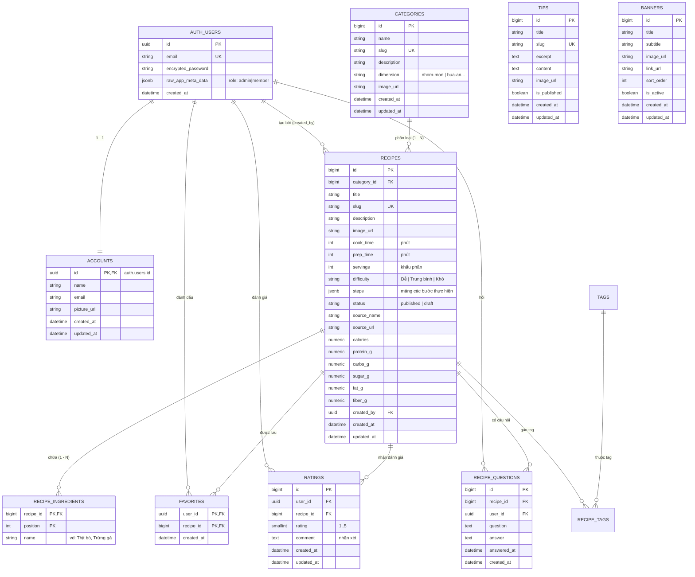

# Đặc tả yêu cầu phần mềm (SRS)
## Website Quản lý & Chia sẻ Công thức Nấu Ăn

- **Đề tài:** Website Quản lý và Chia sẻ Công thức Nấu Ăn
- **Sinh viên thực hiện:** Phạm Tuấn Anh — Lớp DX23TT11, Trường Đại học Trà Vinh
- **Giảng viên hướng dẫn:** ThS. Trầm Hoàng Nam
- **Phiên bản:** 2.0 — Cập nhật theo kiến trúc hiện hành (Next.js 16 + Supabase Native)
- **Hệ thống thực tế (Production):** https://congthucmonngon.vercel.app/

---

## 1. Giới thiệu

### 1.1. Mục đích
Tài liệu Đặc tả yêu cầu phần mềm (SRS) mô tả toàn diện các yêu cầu nghiệp vụ, yêu cầu chức năng, yêu cầu phi chức năng, thiết kế cơ sở dữ liệu và kiến trúc công nghệ cho hệ thống Website Quản lý và Chia sẻ Công thức Nấu Ăn ("Công Thức Việt"). Hệ thống cung cấp nền tảng hai chiều cho phép người dùng xem, tìm kiếm, lưu trữ công thức yêu thích, đánh giá sao, hỏi đáp; đồng thời cung cấp giao diện quản trị viên (Admin) toàn diện để kiểm soát nội dung và bảo mật dữ liệu.

### 1.2. Phạm vi hệ thống
- **Phân hệ công khai & Khách:** Khám phá trang chủ (Banner Carousel, danh mục nổi bật, món ăn mới, ẩm thực 3 miền, mẹo vặt), xem danh sách theo danh mục, xem chi tiết công thức (nguyên liệu dạng checklist, các bước thực hiện, chỉ số dinh dưỡng, gợi ý món liên quan), cẩm nang mẹo vặt ẩm thực, câu hỏi thường gặp (FAQ), tìm kiếm thông minh đa tiêu chí (hỗ trợ tiếng Việt có dấu và không dấu).
- **Phân hệ Thành viên (User đã xác thực):** Đăng ký, đăng nhập, quản lý hồ sơ cá nhân (đổi tên, ảnh đại diện, đổi mật khẩu), đánh dấu/bỏ đánh dấu công thức yêu thích, gửi đánh giá 1–5 sao kèm nhận xét, đặt câu hỏi về công thức.
- **Phân hệ Quản trị viên (Admin Dashboard):** Bảng điều khiển thống kê tổng quan, quản lý danh sách công thức (thêm/sửa/xóa, trạng thái Nháp/Đã xuất bản, xem trước), quản lý danh mục đa chiều (có ảnh minh họa), quản lý mẹo vặt nhà bếp, kiểm duyệt đánh giá, quản lý và phản hồi câu hỏi (Hỏi đáp), thiết lập banner slider trang chủ, quản lý người dùng (phân quyền admin, khóa/mở khóa tài khoản kèm thu hồi session), quản lý thư viện đa phương tiện (Media Storage).

### 1.3. Đối tượng sử dụng (Actors)

| Actor | Mô tả | Quyền hạn chính |
|---|---|---|
| **Khách (Guest)** | Người truy cập chưa đăng nhập | Xem danh mục, công thức xuất bản, mẹo vặt, FAQ, tìm kiếm |
| **Thành viên (User)** | Người dùng đã đăng nhập hệ thống | Quyền của Khách + Yêu thích công thức, Đánh giá 1–5 sao, Hỏi đáp, Hồ sơ cá nhân |
| **Quản trị viên (Admin)** | Người quản trị nội dung và hệ thống | Toàn quyền quản trị: CRUD công thức, danh mục, mẹo vặt, banner, đánh giá, hỏi đáp, media, quản lý tài khoản |

---

## 2. Yêu cầu chức năng

Mã mức ưu tiên: **C** = Cốt lõi (bắt buộc), **N** = Nên có, **T** = Tùy chọn.

### FR1 — Hiển thị công thức theo danh mục món ăn (C)
- Trang chủ và trang danh mục (`/danh-muc`) hiển thị danh sách công thức dạng thẻ card: ảnh đại diện, tên món, nhóm món, thời gian chuẩn bị (`prep_time`), thời gian nấu (`cook_time`), độ khó, điểm đánh giá trung bình.
- Hỗ trợ phân loại danh mục đa chiều (Mặc định: Nhóm món; mở rộng: Phương pháp chế biến, Nguyên liệu chính, Bữa ăn, Phong cách ẩm thực).
- 7 danh mục cốt lõi ban đầu: Món chính, Món tráng miệng, Món khai vị, Món canh, Món chay, Đồ uống, Món ăn vặt.
- Mỗi danh mục có trang riêng (`/danh-muc/[slug]`) liệt kê các công thức thuộc nhóm đó, có phân trang; trạng thái danh mục trống hiển thị thông báo thân thiện.

### FR2 — Trang chi tiết công thức (C)
Mỗi công thức hiển thị tại URL `/cong-thuc/[slug]` bao gồm:
- **Thông tin tổng quan:** Tên món, ảnh đại diện, mô tả ngắn, danh mục, khẩu phần (`servings`), thời gian chuẩn bị (`prep_time`), thời gian nấu (`cook_time`), mức độ khó (Dễ / Trung bình / Khó), nguồn sưu tầm (`source_name`, `source_url`).
- **Giá trị dinh dưỡng:** Accordion hiển thị Năng lượng (kcal), Chất đạm (protein), Tinh bột (carbs), Đường (sugar), Chất béo (fat), Chất xơ (fiber).
- **Nguyên liệu:** Danh sách nhiều dòng gồm tên nguyên liệu và định lượng tương ứng, hiển thị dạng checklist tương tác.
- **Các bước thực hiện:** Danh sách các bước đánh số thứ tự, nội dung mô tả chi tiết, hỗ trợ kèm ảnh minh họa cho từng bước.
- **Tương tác:** Nút "Yêu thích" (trái tim đổi màu), nút "Sao chép link chia sẻ", khối "Công thức liên quan" cùng danh mục.
- **Ràng buộc:** Công thức ở trạng thái Nháp (`draft`) bị chặn truy cập ở phía người dùng thường thông qua Row Level Security (RLS).

### FR3 — Tìm kiếm và lọc công thức (C)
- Ô tìm kiếm xuất hiện trên Header ở mọi trang với dropdown gợi ý tức thì khi gõ từ khóa.
- Trang tìm kiếm chuyên biệt (`/tim-kiem`) hỗ trợ tìm kiếm khớp với: **tên công thức** hoặc **tên nguyên liệu**.
- Xử lý tìm kiếm tối ưu bằng extension PostgreSQL `pg_trgm` kết hợp hàm `unaccent_immutable`: hỗ trợ gõ tiếng Việt không dấu vẫn tìm ra kết quả có dấu (ví dụ: gõ "tom" vẫn tìm thấy "Chả giò tôm mayo").
- Bộ lọc kết hợp: Lọc theo danh mục, mức độ khó, sắp xếp theo mới nhất hoặc điểm đánh giá cao nhất.
- Hiển thị số lượng kết quả tìm thấy và khối giao diện "Không tìm thấy kết quả" thân thiện.

### FR4 — Tài khoản người dùng & Xác thực (C)
- Xác thực trực tiếp qua **Supabase Auth** (email + password):
  - Đăng ký tài khoản tại `/auth/sign-up`: Họ tên, email duy nhất, mật khẩu tối thiểu 8 ký tự. Mặc định tài khoản tạo mới có vai trò Member.
  - Đăng nhập / Đăng xuất tại `/auth/sign-in`: Duy trì phiên đăng nhập bằng HTTP-only Secure Cookie (SSR Session).
- Mật khẩu lưu trữ dưới dạng băm (Bcrypt) trong schema `auth.users`, không bao giờ trả về phía client.
- Trang Hồ sơ cá nhân (`/profile`): Cập nhật họ tên, ảnh đại diện, đổi mật khẩu.
- Tài khoản bị quản trị viên khóa sẽ bị từ chối đăng nhập và thu hồi phiên làm việc ngay lập tức.

### FR5 — Đánh dấu công thức yêu thích (C)
- Chỉ thành viên đã đăng nhập mới có thể lưu công thức yêu thích; khách bấm nút yêu thích sẽ tự động chuyển hướng đến `/auth/sign-in`.
- Nút yêu thích đồng bộ trạng thái (đã lưu / chưa lưu) trên cả thẻ card công thức và trang chi tiết.
- Trang "Công thức yêu thích" (`/yeu-thich`) liệt kê toàn bộ các món thành viên đã lưu, hỗ trợ xóa trực tiếp khỏi danh sách.
- **Ràng buộc toàn vẹn:** Khóa chính kép `(user_id, recipe_id)` đảm bảo mỗi người dùng chỉ yêu thích 1 công thức tối đa 1 lần (Idempotent).

### FR6 — Đánh giá & Hỏi đáp công thức (C)
- **Đánh giá sao:** Thành viên đánh giá điểm số từ 1 đến 5 sao kèm nhận xét; ràng buộc `UNIQUE(user_id, recipe_id)` đảm bảo mỗi người chỉ có 1 đánh giá/món (đánh giá lại = cập nhật đánh giá cũ).
- Điểm trung bình và tổng số lượt đánh giá được tính toán và hiển thị đồng bộ trên thẻ công thức và trang chi tiết.
- **Hỏi đáp công thức:** Người dùng có thể gửi câu hỏi thắc mắc về công thức ngay tại trang chi tiết; quản trị viên phản hồi câu hỏi thông qua trang quản trị `/admin/hoi-dap`.

### FR7 — Phân hệ Quản trị viên toàn diện (C)
Truy cập tại route `/admin`, kiểm tra phân quyền chặt chẽ ở cả Server Middleware, Layout và Row Level Security (RLS) của database (`kit.is_admin()`):

| Chức năng quản trị | Chi tiết thực hiện |
|---|---|
| **Dashboard tổng quan** | Thống kê số lượng công thức, danh mục, đánh giá, người dùng và biểu đồ hoạt động |
| **Quản lý công thức** | Danh sách dạng lưới thẻ card 2 cột; tìm kiếm + bộ lọc danh mục/trạng thái; Thêm / Sửa / Xóa công thức; quản lý nguyên liệu checklist và các bước nấu; Modal xem trước công thức |
| **Quản lý danh mục** | Danh sách dạng lưới; Thêm / Sửa / Xóa danh mục; hỗ trợ tải lên ảnh đại diện danh mục; **Ràng buộc:** Không cho xóa danh mục đang có công thức trực thuộc |
| **Quản lý mẹo vặt** | Danh sách bài viết mẹo vặt ẩm thực dạng lưới; Thêm / Sửa / Xóa bài viết, chuyển trạng thái xuất bản |
| **Quản lý đánh giá** | Lưới duyệt các đánh giá của người dùng; xem số sao, nhận xét; nút liên kết nhanh đến trang chi tiết món; xóa đánh giá vi phạm |
| **Quản lý hỏi đáp** | Danh sách câu hỏi của độc giả; modal trả lời câu hỏi và cập nhật trạng thái đã phản hồi |
| **Quản lý banner** | Quản lý danh sách banner slider trang chủ; thêm, sửa, đổi thứ tự hiển thị (`sort_order`), bật/tắt hiển thị |
| **Quản lý người dùng** | Danh sách tài khoản thành viên; tìm theo tên/email; cấp và thu hồi quyền Admin; khóa/mở khóa tài khoản (thu hồi toàn bộ session token); chặn không cho khóa Admin hoạt động cuối cùng |
| **Quản lý media** | Thư viện hình ảnh phân theo thư mục (`recipes`, `tips`, `categories`, `banners`, `uploads`); upload ảnh trực tiếp lên Supabase Storage |

---

## 3. Yêu cầu phi chức năng

| Mã | Tiêu chuẩn | Nội dung yêu cầu thực tế |
|:---:|---|---|
| **NFR1** | **Hiệu năng & Tốc độ** | Tận dụng cơ chế Server Components (RSC) và Static/SSR của Next.js 16, thời gian tải trang chi tiết < 1.5s; tìm kiếm nguyên liệu với chỉ mục trigram < 0.5s |
| **NFR2** | **Bảo mật hệ thống** | Mật khẩu băm an toàn qua Supabase Auth; cơ chế bảo vệ CSRF và Server Actions; kiểm tra quyền hạn phía máy chủ ở mọi thao tác ghi; Row Level Security (RLS) bảo vệ ở tầng PostgreSQL |
| **NFR3** | **Mobile-First & UI** | Giao diện chuẩn tiếng Việt 100%, thiết kế theo triết lý Mobile-First, hiển thị sắc nét trên màn hình từ 375px trở lên (đã kiểm thử E2E trên viewport 375×812) |
| **NFR4** | **Lưu trữ & Tối ưu Media** | Hình ảnh lưu trữ tại Supabase Storage; sinh tên file ngẫu nhiên chống trùng lặp; Next.js Image Component tự động tối ưu hóa kích thước và chuyển đổi định dạng WebP |
| **NFR5** | **Dữ liệu thực nghiệm** | Cơ sở dữ liệu mẫu seed đầy đủ ≥ 30 công thức nấu ăn thực tế có hình ảnh chuẩn, 7 danh mục món ăn, ≥ 5 tài khoản thử nghiệm |
| **NFR6** | **Kiến trúc mã nguồn** | Cấu trúc Monorepo tiêu chuẩn (Next.js App Router, `@kit/ui`, `@kit/supabase`), quản lý mã nguồn chặt chẽ qua Git branching (`dev` → `main`) |

---

## 4. Thiết kế cơ sở dữ liệu (PostgreSQL / Supabase)

### 4.1. Sơ đồ thực thể liên kết (ERD)



### 4.2. Chỉ mục và Hàm tối ưu tìm kiếm
- **Khóa chính & Ràng buộc toàn vẹn:**
  - `favorites`: Khóa chính kép `(user_id, recipe_id)` ngăn trùng lặp yêu thích.
  - `ratings`: Ràng buộc `UNIQUE(user_id, recipe_id)` đảm bảo 1 người chỉ đánh giá 1 lần/món.
  - `recipes.slug`, `categories.slug`, `tips.slug`: Khóa Unique tự sinh chống trùng đường dẫn.
- **Chỉ mục truy vấn (B-Tree Indexes):**
  - `recipes(category_id)`, `recipes(status)`, `recipes(slug)`.
  - `recipe_ingredients(recipe_id)`, `favorites(recipe_id)`, `ratings(recipe_id)`.
- **Chỉ mục tìm kiếm Trigram (GIN Trigram Index):**
  - Tích hợp extension `pg_trgm` trên bảng `recipe_ingredients(name)` và `recipes(title)`.
  - Sử dụng hàm bất biến `kit.unaccent_immutable()` để tìm kiếm không phân biệt dấu tiếng Việt.

---

## 5. Thiết kế màn hình, Route & Server Actions

### 5.1. Sơ đồ cây Route (Next.js App Router)

```
apps/web/app/
├── (marketing)/
│   ├── page.tsx                    /                       Trang chủ (Banner, Món mới, 3 miền, Footer)
│   ├── danh-muc/
│   │   ├── page.tsx                /danh-muc               Danh sách 7 nhóm món ăn
│   │   └── [slug]/page.tsx         /danh-muc/[slug]        Món ăn theo danh mục (có phân trang)
│   ├── cong-thuc/
│   │   └── [slug]/page.tsx         /cong-thuc/[slug]       Chi tiết công thức (Nguyên liệu, Bước, Đánh giá, Hỏi đáp)
│   ├── tim-kiem/page.tsx           /tim-kiem               Tìm kiếm công thức + bộ lọc danh mục/vùng miền
│   ├── meo-vat/
│   │   ├── page.tsx                /meo-vat                Cẩm nang mẹo vặt nhà bếp
│   │   └── [slug]/page.tsx         /meo-vat/[slug]         Chi tiết bài viết mẹo vặt
│   ├── faq/page.tsx                /faq                    Trang câu hỏi thường gặp
│   ├── yeu-thich/page.tsx          /yeu-thich              Danh sách món ăn yêu thích của thành viên
│   └── profile/page.tsx            /profile                Quản lý hồ sơ cá nhân và đổi mật khẩu
├── auth/
│   ├── sign-in/page.tsx            /auth/sign-in           Đăng nhập tài khoản
│   ├── sign-up/page.tsx            /auth/sign-up           Đăng ký tài khoản mới
│   └── callback/route.ts           /auth/callback          Xử lý phiên xác thực Supabase
└── admin/
    ├── page.tsx                    /admin                  Dashboard thống kê tổng quan
    ├── cong-thuc/
    │   ├── page.tsx                /admin/cong-thuc        Quản lý danh sách công thức dạng lưới
    │   └── moi/page.tsx            /admin/cong-thuc/moi    Form thêm mới công thức
    ├── danh-muc/
    │   ├── page.tsx                /admin/danh-muc         Quản lý danh mục món ăn (dạng lưới + ảnh)
    │   └── moi/page.tsx            /admin/danh-muc/moi     Form thêm danh mục mới
    ├── meo-vat/
    │   ├── page.tsx                /admin/meo-vat          Quản lý cẩm nang mẹo vặt
    │   └── moi/page.tsx            /admin/meo-vat/moi      Form soạn thảo bài viết mẹo vặt
    ├── danh-gia/page.tsx           /admin/danh-gia         Kiểm duyệt đánh giá người dùng
    ├── hoi-dap/page.tsx            /admin/hoi-dap          Quản lý và phản hồi câu hỏi người dùng
    ├── banner/page.tsx             /admin/banner           Quản lý banner slider trang chủ
    ├── user/page.tsx               /admin/user             Quản lý người dùng, phân quyền, khóa tài khoản
    └── media/page.tsx              /admin/media            Quản lý thư viện hình ảnh Storage
```

### 5.2. Kiến trúc Server Actions & API Supabase

Thay vì sử dụng REST API truyền thống dễ lộ endpoint và phân tán logic, hệ thống ứng dụng kiến trúc **Server Actions (Next.js)** kết hợp **Supabase Client**:

| Thao tác nghiệp vụ | File định nghĩa | Quyền hạn | Cơ chế bảo vệ & Mô tả |
|---|---|:---:|---|
| `toggleFavoriteAction` | `components/recipes/actions.ts` | Member | Kiểm tra session; thêm/bỏ món yêu thích |
| `rateRecipeAction` | `components/recipes/actions.ts` | Member | Kiểm tra session; ghi nhận/cập nhật điểm 1–5 sao |
| `deleteRatingAction` | `components/recipes/actions.ts` | Member | Xóa đánh giá của chính người dùng |
| `askQuestionAction` | `components/recipes/actions.ts` | Member | Gửi câu hỏi thắc mắc về công thức |
| `createRecipeAction` | `app/admin/cong-thuc/actions.ts` | Admin | Server-side role check; tạo công thức + nguyên liệu + bước |
| `updateRecipeAction` | `app/admin/cong-thuc/actions.ts` | Admin | Cập nhật công thức và đồng bộ nguyên liệu |
| `deleteRecipeAction` | `app/admin/cong-thuc/actions.ts` | Admin | Xóa công thức có hộp thoại xác nhận |
| `createCategoryAction` | `app/admin/danh-muc/actions.ts` | Admin | Tạo danh mục mới kèm upload ảnh |
| `deleteCategoryAction` | `app/admin/danh-muc/actions.ts` | Admin | Chặn xóa danh mục nếu đang có món trực thuộc |
| `answerQuestionAction` | `app/admin/hoi-dap/actions.ts` | Admin | Lưu câu trả lời và cập nhật `answered_at` |
| `toggleUserLockAction` | `app/admin/user/actions.ts` | Admin | Khóa tài khoản và gọi RPC thu hồi toàn bộ session token |
| `updateUserRoleAction` | `app/admin/user/actions.ts` | Admin | Cấp/thu hồi quyền admin; chặn thu hồi admin cuối cùng |
| `search_recipes` (RPC) | `supabase/migrations/...` | Public | Hàm PostgreSQL tìm kiếm trigram không dấu |

---

## 6. Ngăn xếp công nghệ thực tế (Tech Stack)

| Lớp kiến trúc | Công nghệ áp dụng | Vai trò & Lý do lựa chọn |
|---|---|---|
| **Frontend Framework** | **Next.js 16 (App Router) + TypeScript** | Server Components (RSC) tối ưu SEO, hỗ trợ Server Actions xử lý dữ liệu an toàn, render trang tĩnh và động tốc độ cao |
| **Giao diện & Styling** | **Tailwind CSS v4 + @kit/ui (shadcn/ui)** | Thiết kế hiện đại, responsive chuẩn Mobile-First (375px+), bộ UI Component tiêu chuẩn doanh nghiệp |
| **Cơ sở dữ liệu** | **PostgreSQL (Supabase)** | Hệ quản trị CSDL quan hệ mạnh mẽ, hỗ trợ kiểu dữ liệu `jsonb`, extension `pg_trgm` tìm kiếm nguyên liệu tối ưu |
| **Xác thực & Bảo mật** | **Supabase Auth + Row Level Security (RLS)** | Quản lý phiên đăng nhập an toàn qua HttpOnly Cookie, bảo mật dữ liệu ở tầng CSDL bằng chính sách RLS |
| **Lưu trữ đa phương tiện** | **Supabase Storage** | Lưu trữ ảnh đại diện món ăn, ảnh các bước nấu, ảnh danh mục, ảnh mẹo vặt qua các Storage Bucket chuyên biệt |
| **Quản lý Monorepo** | **MakerKit + pnpm workspace + Turbo** | Tách bạch các package dùng chung (`@kit/ui`, `@kit/supabase`), tối ưu tốc độ build và typecheck |
| **Nền tảng Hosting** | **Vercel** | Nền tảng đám mây triển khai Next.js tối ưu nhất thế giới, hỗ trợ Edge Network và CI/CD tự động |

---

## 7. Tiêu chí nghiệm thu hệ thống (Acceptance Criteria)

1. **Khám phá & Chi tiết:** Khách và thành viên xem đầy đủ thông tin của 7 nhóm danh mục món ăn và toàn bộ 37+ công thức thật (ảnh món, bảng định lượng nguyên liệu, các bước nấu, giá trị dinh dưỡng) — Đạt yêu cầu FR1, FR2.
2. **Tìm kiếm thông minh:** Tìm kiếm chính xác món ăn theo cả tên món và nguyên liệu, hỗ trợ tiếng Việt có dấu và không dấu (gõ "ga" ra "cơm gà", "canh gà") — Đạt yêu cầu FR3.
3. **Thành viên & Tương tác:** Đăng ký, đăng nhập an toàn; thao tác yêu thích và đánh giá sao 1–5 phản hồi tức thì; đảm bảo chặt chẽ quy tắc 1 người dùng/1 lượt — Đạt yêu cầu FR4, FR5, FR6.
4. **Quản trị toàn diện:** Quản trị viên thực hiện đầy đủ các thao tác thêm, sửa, xóa công thức, danh mục, mẹo vặt, banner, kiểm duyệt đánh giá, trả lời hỏi đáp và quản lý tài khoản người dùng — Đạt yêu cầu FR7.
5. **Bảo mật & Phân quyền:** Toàn bộ API và thao tác ghi dữ liệu được kiểm tra quyền ở phía máy chủ (Server Actions) và bảo vệ bằng RLS ở tầng PostgreSQL; mật khẩu băm mã hóa an toàn — Đạt yêu cầu NFR2.
6. **Mobile Responsive:** Giao diện co giãn mượt mà, thân thiện trên màn hình điện thoại di động từ 375px trở lên — Đạt yêu cầu NFR3.
